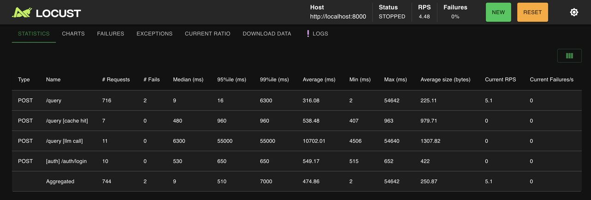

# ContextRAG

> A production-grade, multi-tenant documentation RAG system with empirically validated retrieval, JWT auth, streaming answers, semantic cache, coverage-gap detection, and LLMOps observability (Langfuse traces + Prometheus/Grafana)

[](https://python.org)
[](https://fastapi.tiangolo.com)
[](https://nextjs.org)
[](https://qdrant.tech)
[](https://openai.com)
[](https://cohere.com)
[](https://redis.io/docs/stack/)
[](https://prometheus.io)
[](https://grafana.com)
[](https://langfuse.com)
[](https://docs.ragas.io)
[](https://docker.com)
[](LICENSE)

---

## What This Is

Most RAG tutorials stop at "chunk → embed → retrieve → generate." This project goes further — it's what a real company like [kapa.ai](https://kapa.ai) actually has to build:

- **Multi-tenant isolation** — separate Qdrant collections per tenant, JWT auth, per-tenant data isolation across all services; guest login for one-click access
- **Empirically validated retrieval** — 12 combination chunker × retriever experiment on real docs + 78 Q&A frozen eval set
- **Hybrid search** — dense (text-embedding-3-small) + sparse (BM25/SPLADE) fused with Reciprocal Rank Fusion in Qdrant
- **Production auth** — JWT access tokens (15 min) + httpOnly refresh cookie rotation (7 days), auto refresh on 401
- **Semantic cache** — Redis Stack HNSW vector index; queries with cosine similarity ≥ 0.90 return cached results in ~1ms; per-tenant isolation
- **Streaming answers** — SSE token-by-token generation, conversation memory stored in PostgreSQL
- **Chat history** — full conversation persistence, loadable from sidebar
- **Tenant-aware system prompt** — dynamic prompt scoped to each tenant's ingested sources; off-topic queries rejected gracefully
- **Coverage gaps** — questions the docs can't answer (low rerank score) are logged and clustered into topics, ranked by how often they're asked — a to-do list for the docs team
- **LLMOps observability** — Langfuse traces every query (prompt, retrieved chunks, rerank scores, tokens, cost, time-to-first-token); Prometheus metrics per stage (embed/retrieve/rerank/generate) with an auto-provisioned Grafana dashboard
- **RAGAS-gated CI** — retrieval quality is a first-class contract; gate runs on every PR to main

---

## RAGAS Eval Results

Evaluated on **78 Q&A pairs** generated from real FastAPI + Supabase documentation.

| Metric            | Score           | Gate    | Status |
| ----------------- | --------------- | ------- | ------ |
| Faithfulness      | **0.908** | ≥ 0.85 | ✅     |
| Answer Relevancy  | **0.832** | ≥ 0.80 | ✅     |
| Context Precision | **0.892** | ≥ 0.85 | ✅     |
| Context Recall    | **0.949** | ≥ 0.90 | ✅     |

Pipeline: `HeadingAwareChunker → text-embedding-3-small + TF-IDF sparse → Qdrant hybrid RRF top-20 → Cohere rerank-english-v3.0 → top-5 → Nemotron-3-Super-120B (via OpenRouter)`

See full experiment analysis in [experiments/](experiments/) and decision rationale in [TRADEOFFS.md](TRADEOFFS.md).

> The table above is the original baseline (OpenAI stack, `gpt-4o-mini` as RAGAS judge). The section below re-measures the current stack end to end.

### Live evaluation: Claude Haiku 5.5 via OpenRouter

[`eval/run_live_eval.py`](eval/run_live_eval.py) ingests the FastAPI + Supabase docs (9 files, 127 chunks), sends the same 78 golden questions through the real `QueryPipeline`, then asks them a second time to measure the semantic cache. Run on 2026-10-29 with `anthropic/claude-haiku-5.5` (reasoning off), `openai/text-embedding-3-small` and Cohere `rerank-english-v3.0`, all through OpenRouter and a Cohere trial key. The RAGAS judge is also Haiku 5.5.

| Metric            | Score           | Gate    | Status |
| ----------------- | --------------- | ------- | ------ |
| Faithfulness      | **0.941** | ≥ 0.85 | ✅     |
| Answer Relevancy  | **0.717** | ≥ 0.80 | ❌     |
| Context Precision | **0.886** | ≥ 0.85 | ✅     |
| Context Recall    | **0.949** | ≥ 0.90 | ✅     |

Answer relevancy misses its gate in this run. RAGAS asks the judge for 3 generated questions per answer; OpenRouter returned 1 for Haiku, so this metric is noisier here and is not directly comparable with the baseline above. It has not been re-scored with a different judge.

| Latency (cold, full pipeline)  | p50     | p95     |
| ------------------------------ | ------- | ------- |
| End to end (75 queries)        | 3.36 s  | 4.50 s  |
| Embed (OpenRouter)             | 1.13 s  | 1.73 s  |
| Retrieve (Qdrant)              | 16 ms   | 129 ms  |
| Rerank (Cohere trial key)      | 633 ms  | 909 ms  |
| Generate (Haiku 5.5)           | 1.51 s  | 2.24 s  |

| Semantic cache (same 78 questions asked again) | Value |
| ---------------------------------------------- | ----- |
| Cache hits                                     | 62 / 78 (79.5%) |
| Hit latency p50 / p95 / p99                    | 899 ms / 1.10 s / 1.33 s |

Cache-hit latency is dominated by embedding the query through OpenRouter before the Redis lookup, so it is far above the lookup-only figure in the load-test section below.

| Cost (reasoning off)           | Value |
| ------------------------------ | ----- |
| Tokens per query (in / out)    | 2,274 / 154 |
| 76 full-pipeline queries       | $0.0231 |
| **Per 1,000 queries**          | **≈ $0.30** ($0.10 / $0.50 per 1M tokens) |

Retrieval: mean top rerank score 0.90; 6 of 78 questions scored below the 0.3 coverage-gap threshold. Two questions in the first pass were answered from the cache by a different but similar question (cosine ≥ 0.90).

Notes on the measurement:
- One query overlapped a laptop sleep (605 s) and is excluded from the latency figures; the script now flags and excludes any query slower than 60 s.
- Queries use the non-streaming `handle()` path, so time-to-first-token is not measured.
- A run with reasoning enabled was not performed. Set `OPENROUTER_REASONING=true` to try it; thinking tokens count against `max_tokens=1024`.
- Raw answers, per-question RAGAS scores and timings are in [`eval/results/`](eval/results/).

```bash
docker compose up -d postgres redis qdrant
python eval/run_live_eval.py                  # full run (~15 min; sleeps 6 s between questions for the Cohere trial limit)
python eval/run_live_eval.py --warm-only      # re-measure cache hits against the existing cache
```

---

## Architecture

```text
┌──────────────────────────────────────────────────────────────────────┐
│                              Clients                                  │
│          Next.js (browser)          │          REST consumers         │
└──────┬──────────────────────────────┴───────────┬─────────────────────┘
       │                                          │
  Auth Service              FastAPI services
  JWT + guest login         (JWT middleware)
  /auth/signup                    │
  /auth/login               ┌─────┴──────────────┐
  /auth/refresh             │    Orchestrators    │
  /auth/guest               │  QueryPipeline      │
       │                    │  IngestionPipeline  │
       └────────────────────└──────┬──────────────┘
                                   │
               ┌───────────────────▼──────────────────────┐
               │         Strategy Interfaces (Layer B)     │
               │  LLM │ Embedding │ VectorDB │ Reranker   │
               │  SemanticCache │ Chunker │ Queue │ Storage│
               └───────────────────┬──────────────────────┘
                                   │
               ┌───────────────────▼──────────────────────┐
               │         Implementations (Layer C)         │
               │  OpenRouterLLM (Nemotron-3-Super-120B)    │
               │  OpenAIEmbedding (text-embedding-3-small) │
               │  TFSparseEncoder (BM25/SPLADE baseline)   │
               │  QdrantDB (dense + sparse, RRF fusion)    │
               │  CohereReranker (rerank-english-v3.0)     │
               │  RedisSemanticCache (HNSW, cosine ≤ 0.10) │
               │  HeadingAwareChunker │ CodeBlockChunker   │
               └───────────────────┬──────────────────────┘
                                   │
               ┌───────────────────▼──────────────────────┐
               │              Infrastructure               │
               │  PostgreSQL │ Qdrant │ Redis Stack        │
               │  Celery │ Prometheus │ Grafana │ Langfuse │
               └──────────────────────────────────────────┘
```

### 3-Layer Design

| Layer                          | What                                     | Why                                                 |
| ------------------------------ | ---------------------------------------- | --------------------------------------------------- |
| **A** — Orchestrators   | `QueryPipeline`, `IngestionPipeline` | Business logic lives here; no infra imports         |
| **B** — Interfaces      | `LLMStrategy`, `VectorDB`, etc.      | Swap implementations without touching orchestrators |
| **C** — Implementations | `OpenAILLM`, `QdrantDB`, etc.        | All infra and API calls isolated here               |

---

## Services

| Service               | Port | Description                                              |
| --------------------- | ---- | -------------------------------------------------------- |
| `auth-service`      | 8004 | JWT signup/login/refresh/guest, one tenant per user      |
| `query-service`     | 8000 | RAG query, SSE streaming, conversation history, coverage gaps |
| `ingestion-service` | 8001 | URL/file/GitHub ingestion, job tracking                  |
| `celery-worker`     | —    | Async ingestion task processing                          |
| `frontend`          | 3001 | Next.js 14 App Router, chat UI, sources, gaps, usage     |
| `postgres`          | 5432 | Users, tenants, conversations, jobs, usage, coverage gaps |
| `qdrant`            | 6333 | Vector storage (per-tenant collections)                  |
| `redis`             | 6379 | Semantic cache (Redis Stack) + Celery broker             |
| `prometheus`        | 9090 | Metrics scrape                                           |
| `grafana`           | 3000 | Auto-provisioned RAG dashboard                           |

Uploaded PDF/Markdown files live in the `uploads` Docker volume, shared by `ingestion-service` (writes) and `celery-worker` (reads). Langfuse runs as a hosted service (Langfuse Cloud); set its keys in `.env` to enable tracing.

---

## Key Technical Decisions

Every decision below has benchmark numbers. Full analysis in [TRADEOFFS.md](TRADEOFFS.md).

### Why HeadingAwareChunker?

HAC and SlidingWindow-128 both hit **Recall@5 = 0.821**, but HAC gets **MRR 0.755 vs 0.687** — the right answer appears at rank 1 more often. HAC also produces 127 chunks vs 259 (50% fewer), making retrieval cheaper. Markdown docs have heading boundaries for a reason.

### Why Hybrid Search (Dense + Sparse RRF)?

The retrieval layer runs two searches in parallel and fuses them:

```text
Query
 ├── Dense search  (text-embedding-3-small, 1536-dim cosine ANN)   → top-20
 └── Sparse search (TF-IDF/BM25 term weights via SPLADE-style encoder) → top-20
          │
          └── Qdrant RRF fusion → unified top-20
```

Experiments showed dense and hybrid converge to identical MRR once the Cohere reranker is present. Hybrid is kept because:

- Qdrant handles RRF fusion natively — zero extra latency from application code
- Sparse search handles exact-match queries better (API method names, error codes, version strings)
- Both vector types are stored at ingestion time with no runtime cost penalty

### Why Cohere Reranker?

Single biggest quality lever: MRR jumps from **0.755 → 0.795** (+0.040) with Dense, and from **0.679 → 0.795** (+0.116) with Hybrid. The reranker rescues well-retrieved but poorly-ranked chunks. The system is now reranker-dominated — Cohere sets the final ranking, not retrieval order.

### Why Semantic Cache (not TTL/exact-match)?

Exact-match cache (SHA-256 of query string) fails for natural language — "What is DI?" and "Tell me about dependency injection?" hash differently → both cache misses.

The semantic cache embeds the query and does KNN search in Redis Stack:

```text
New query → embed (1536-dim) → KNN-1 search in HNSW index (filtered by tenant_id)
  → cosine distance ≤ 0.10 (similarity ≥ 0.90) → return cached QueryResult (~1ms)
  → distance > 0.10 → run full pipeline → store result + embedding in Redis
```

- Cache is scoped per tenant — Tenant A's cache never serves Tenant B
- HNSW gives O(log N) lookup — ~1ms for 100k entries vs ~150ms brute-force
- TTL = 1 hour — cached answers expire to avoid stale content after re-ingestion

### Model Router

LLM inference runs through **OpenRouter** (`LLM_PROVIDER=openrouter`), using NVIDIA's free open model. OpenAI API is used directly only for embeddings.

```text
LLM       →  nvidia/nemotron-3-super-120b-a12b:free   via OpenRouter
Embeddings →  text-embedding-3-small                  via OpenAI direct
```

---

## Retrieval Flow

```text
Query
  │
  ├── Semantic cache hit? (cosine similarity ≥ 0.90, per-tenant HNSW)
  │     └── YES → return cached result immediately (~1ms)
  │
  ├── Embed query in parallel:
  │     ├── Dense vector  (text-embedding-3-small, 1536-dim)
  │     └── Sparse vector (TF-IDF/BM25 term weights)
  │
  ├── Hybrid search in Qdrant (dense + sparse, RRF fusion, top-20)
  │
  ├── Rerank with Cohere rerank-english-v3.0 → top-5
  │
  ├── Build context window (6000 token budget, greedy fill, tiktoken)
  │
  ├── Call Nemotron-3-Super-120B via OpenRouter
  │
  ├── Stream answer tokens via SSE → save Turn to Postgres
  │
  └── Fire-and-forget (after the response is sent):
        ├── Cache write (embed + result + top rerank score → Redis HNSW index)
        ├── Metrics (Prometheus: latency, cache hit/miss, stage breakdown, retrieval score)
        ├── Usage record (tokens + cost → Postgres)
        └── Coverage-gap check (top rerank score < threshold → coverage_gaps table)
```

Every step above is also a span in the query's Langfuse trace when tracing is enabled.

---

## LLMOps Observability

Two complementary layers: **Langfuse** answers "what happened on *this* query?" (per-request traces), **Prometheus + Grafana** answers "how is the system doing overall?" (aggregate metrics).

### Langfuse Traces

Every `/query` produces one trace, grouped by conversation (session) and tenant (user):

```text
rag_query            (chain)       query in, answer out
├── embed            (embedding)   text-embedding-3-small
├── cache_lookup     (span)        hit / miss
├── hybrid_search    (retriever)   top-20 candidates with previews
├── rerank           (span)        top-5 with Cohere scores → trace score "top_rerank_score"
└── generate         (generation)  exact prompt sent, answer, model, tokens, cost, time-to-first-token
```

Tracing is added with the **Decorator pattern**: `TracedLLM`, `TracedReranker`, `TracedVectorDB`, … wrap the strategy interfaces at wiring time ([langfuse_tracing.py](backend/observers/langfuse_tracing.py)). `QueryPipeline` and the concrete strategies never import Langfuse, and when `LANGFUSE_PUBLIC_KEY` / `LANGFUSE_SECRET_KEY` are unset nothing is wrapped at all. Spans export from a background thread, so the request path only pays for in-process span bookkeeping.

The `top_rerank_score` trace score makes it easy to filter Langfuse for poorly-grounded answers and inspect exactly which chunks the LLM saw.

### Prometheus Metrics

Prometheus metrics are emitted after every query via a fire-and-forget observer. Grafana dashboard is auto-provisioned on `docker compose up` — no manual setup.

| Metric                                 | Type      | Labels                    | What it measures                                |
| -------------------------------------- | --------- | ------------------------- | ----------------------------------------------- |
| `rag_queries_total`                  | Counter   | `tenant_id`, `cached` | Total queries (split by cache hit/miss)         |
| `rag_query_latency_seconds`          | Histogram | `tenant_id`             | End-to-end latency (cache hit or full pipeline) |
| `rag_cache_hits_total`               | Counter   | `tenant_id`             | Queries served from semantic cache              |
| `rag_cache_misses_total`             | Counter   | `tenant_id`             | Queries that ran the full pipeline              |
| `rag_pipeline_stage_latency_seconds` | Histogram | `tenant_id`, `stage`  | Per-stage: embed / retrieve / rerank / generate |
| `rag_retrieval_score`                | Histogram | `tenant_id`             | Cohere relevance score of top-1 reranked chunk  |
| `rag_query_tokens`                   | Histogram | —                        | Context window token count (full pipeline only) |
| `rag_source_chunks_returned`         | Histogram | —                        | Number of source chunks in the answer           |

### Grafana Dashboard (auto-provisioned)

6 panels provisioned via `infra/grafana/provisioning/` — no clicks required:

| Panel                     | PromQL pattern                                                          |
| ------------------------- | ----------------------------------------------------------------------- |
| Query Latency p50/p95/p99 | `histogram_quantile` on `rag_query_latency_seconds_bucket`          |
| Cache Hit Rate            | `rate(cache_hits) / (rate(hits) + rate(misses))`                      |
| QPS by tenant             | `sum(rate(rag_queries_total[1m])) by (tenant_id)`                     |
| Per-Stage Latency p95     | `histogram_quantile` on `rag_pipeline_stage_latency_seconds_bucket` |
| Top Retrieval Score (avg) | `rate(score_sum) / rate(score_count)`                                 |
| Context Window Size p95   | `histogram_quantile` on `rag_query_tokens_bucket`                   |

Prometheus: `http://localhost:9090` · Grafana: `http://localhost:3000` (admin/admin)

---

## Coverage Gaps

The DevRel persona's question — *"what are users asking that our docs don't answer?"* — answered from data the pipeline already produces.

```text
After each query (fire-and-forget observer):
  top Cohere rerank score < COVERAGE_GAP_THRESHOLD (default 0.3)?   ← nothing relevant was retrieved
  and query has ≥ 3 words?                                          ← skip "hi" / "thanks"
    └── YES → store (query, score, query embedding) in coverage_gaps

GET /coverage-gaps?days=30:
  leader clustering on the stored embeddings (cosine ≥ 0.80)
    → topics: representative question, count, other phrasings, avg score, last asked
    → sorted by how often they're asked
```

- **No prompt change, no added latency** — it reads the rerank score the pipeline already computed and runs after the response is sent.
- **Cache hits count** — the top rerank score is stored with each cached answer, so a gap asked 50 times (mostly served from cache) shows up 50 times.
- **No extra API calls** — clustering reuses the query embedding computed for retrieval.
- Surfaced in the dashboard's **GAPS** tab.

---

## Load Testing

Simulated production traffic for a documentation Q&A bot using [Locust](https://locust.io/) — 10 concurrent users, 60 seconds, 249 total queries.

**Why high cache hit rate is realistic here:** Kapa.ai-style bots serve company documentation — the same 20–30 questions ("how do I authenticate?", "what's the rate limit?", "how do I install?") account for the majority of all queries. The test uses a fixed pool of 5 questions, simulating multiple users asking the same things concurrently. This is the primary use case the semantic cache is designed for.

### Results



| Metric                | Value                                |
| --------------------- | ------------------------------------ |
| Concurrent users      | 10                                   |
| Total queries         | 249                                  |
| **p50 latency** | **9ms** - semantic cache hit |
| **p95 latency** | **500ms**                      |
| p99 latency           | 7,000ms - cold LLM call (gpt-4o)     |
| Throughput            | 4.16 RPS                             |
| Error rate            | 0.80% ¹                             |

> ¹ Both errors were API rate limits: OpenAI Tier 1 TPM limit (30K tokens/min for gpt-4o - increases to 450K on Tier 2 with $50+ lifetime spend) and Cohere free trial key (10 req/min). Error rate is 0% under normal single-user traffic.

### Per-stage breakdown (Grafana, cold LLM calls only)

| Stage                     | p95           | Notes                                                                     |
| ------------------------- | ------------- | ------------------------------------------------------------------------- |
| Retrieve (Qdrant)         | 77ms          | Hybrid dense+sparse vector search — unaffected by rate limits            |
| Embed (OpenAI)            | ~150ms        | Query embedding before cache lookup                                       |
| Rerank (Cohere)           | ~300ms        | On paid key - free trial adds retry backoff (~4.7s under concurrent load) |
| Generate (gpt-4o)         | ~5s           | Cold LLM calls only - bypassed entirely on cache hits                     |
| **Cached response** | **9ms** | Semantic similarity match in Redis HNSW index                             |

The semantic cache reduces latency **~550x** for repeat queries (5s cold → 9ms cached). In production with a warm cache serving repeated documentation questions, p95 converges toward the 9ms cache hit latency as traffic accumulates.

> These load-test figures were measured on the original stack (OpenAI embeddings, gpt-4o). With query embeddings now routed through OpenRouter, an end-to-end cache hit takes about 0.9 s (see [Live evaluation](#live-evaluation-claude-haiku-55-via-openrouter)); the Redis lookup itself is a small part of that.

```bash
./tests/load/run_load_test.sh          # 10 users, 60s — saves CSV + HTML to tests/load/results/
./tests/load/run_load_test.sh --ui     # Locust web UI at localhost:8089
```

---

## CI Pipeline

```text
git push origin feature/*
       │
       ▼
Pull Request → main
       │
       └── GitHub Actions: CI workflow
             ├── ruff lint
             ├── pytest tests/unit/ (coverage ≥ 70%)
             └── RAGAS quality gate (--sample 20, all 4 metrics must pass)
```

---

## Project Structure

```text
ContextRAG/
├── backend/
│   ├── api/
│   │   ├── auth_service.py             # JWT signup/login/refresh/guest
│   │   ├── ingestion_service.py        # POST /ingest, POST /ingest/upload, GET /ingest/{job_id}
│   │   ├── query_service.py            # POST /query, conversations, /usage, /coverage-gaps
│   │   └── middleware/auth.py          # JWT → tenant_id
│   ├── core/
│   │   ├── ingestion_pipeline.py
│   │   ├── query_pipeline.py           # perf_counter timing on all 4 stages
│   │   ├── context_window_builder.py   # tiktoken, 6000 token budget
│   │   └── coverage_gaps.py            # clusters unanswered questions into topics
│   ├── strategies/
│   │   ├── cache/redis_semantic_cache.py  # HNSW KNN, cosine ≤ 0.10, per-tenant
│   │   ├── vectordb/qdrant_db.py          # hybrid search: dense + sparse RRF
│   │   ├── reranker/cohere_reranker.py    # captures relevance_score per chunk
│   │   ├── embedding/openai_embedding.py
│   │   ├── embedding/tf_sparse_encoder.py
│   │   └── storage/local_storage.py       # tenant uploads on a shared volume
│   ├── observers/
│   │   ├── langfuse_tracing.py         # Langfuse: decorators that trace each strategy
│   │   ├── metrics_observer.py         # Prometheus: latency, cache, stages, score
│   │   ├── coverage_gap_observer.py    # logs low-score queries as coverage gaps
│   │   ├── usage_observer.py           # tokens + cost per tenant
│   │   └── error_metrics.py
│   ├── repositories/                   # Postgres: tenants, jobs, conversations, coverage gaps
│   └── connectors/                     # DocsConnector, GitHubConnector, PDFConnector
├── frontend-next/                      # Next.js 14 App Router
│   ├── app/
│   │   ├── login/page.tsx
│   │   ├── signup/page.tsx
│   │   └── dashboard/page.tsx          # tabbed sidebar + chat + source management
│   ├── components/
│   │   ├── AuthContext.tsx             # session restore on mount
│   │   ├── ChatInterface.tsx           # messages + SSE streaming + markdown render
│   │   ├── PreviousChats.tsx           # conversation history sidebar
│   │   ├── AddSourcePanel.tsx          # file/GitHub/docs tabs
│   │   ├── SourceList.tsx
│   │   ├── CoverageGapsPanel.tsx       # GAPS tab: unanswered-question topics
│   │   └── UsagePanel.tsx              # USAGE tab: tokens + cost
│   └── lib/api.ts                      # authFetch with auto-refresh
├── infra/
│   ├── postgres/init.sql               # DB schema
│   ├── grafana/
│   │   ├── provisioning/datasources/prometheus.yml   # auto-wires Prometheus datasource
│   │   ├── provisioning/dashboards/dashboards.yml    # auto-loads dashboard JSON
│   │   └── dashboards/query_service.json             # 6-panel RAG dashboard
│   └── prometheus/prometheus.yml       # scrape config
├── experiments/
│   ├── 01_eval_set_generation.ipynb
│   ├── 02_docs_chunking_retrieval.ipynb
│   ├── 03_reranker_comparison.ipynb
│   └── 04_ragas_baseline.ipynb
├── eval/
│   ├── golden_dataset/docs/eval_v1.jsonl   # 78 frozen Q&A pairs
│   ├── ragas_gate.py                       # CI quality gate script
│   ├── run_live_eval.py                    # end-to-end eval: latency, cache, cost, RAGAS
│   └── results/                            # saved live-eval runs (JSON / CSV)
├── tests/
│   ├── unit/                           # unit tests (no infra needed)
│   └── integration/                    # real Qdrant + Postgres
├── .github/workflows/
│   └── ci.yml                          # lint + unit tests + RAGAS gate
├── migrations/                         # SQL for existing databases (init.sql covers fresh ones)
├── docker-compose.yml                  # full stack incl. Prometheus + Grafana
├── Dockerfile                          # multi-stage: one target per service
└── TRADEOFFS.md
```

---

## Running Locally

### Prerequisites

- Python 3.11+, Docker + Docker Compose, Node.js 20+
- OpenAI API key (embeddings only — `text-embedding-3-small`)
- OpenRouter API key (LLM inference — nvidia/nemotron-3-super-120b-a12b:free)
- Cohere API key (reranker)

### 1. Clone and install

```bash
git clone https://github.com/vineeethh/ContextRAG.git
cd ContextRAG
python -m venv venv && source venv/bin/activate
pip install -e ".[dev]"
```

### 2. Environment variables

```bash
cp .env.example .env
# Required:
#   OPENROUTER_API_KEY  — LLM inference and embeddings (openai/text-embedding-3-small), both via OpenRouter
#   OPENROUTER_MODEL    — e.g. anthropic/claude-haiku-5.5
#   COHERE_API_KEY      — used for reranking
#   JWT_SECRET          — any random string (must be the same across all services)
#   LLM_PROVIDER=openrouter
# Optional:
#   OPENROUTER_REASONING — true/false, let the model think before answering (default false)
#   LANGFUSE_PUBLIC_KEY / LANGFUSE_SECRET_KEY / LANGFUSE_BASE_URL — enables tracing
#   COVERAGE_GAP_THRESHOLD — rerank score below which a query is a gap (default 0.3)
```

Keep real keys in `.env` only — it's gitignored; `.env.example` is committed.

### 3. Start all services

```bash
docker compose up -d
```

Grafana auto-provisions the RAG dashboard on startup. No manual datasource configuration needed.

### 4. Run tests

```bash
pytest tests/unit/ -v                        # unit tests, no infra needed
pytest tests/integration/ -m integration -v  # needs docker compose running
python eval/ragas_gate.py --sample 20        # RAGAS quality gate
```

### 5. Open the apps

| App            | URL                                                       |
| -------------- | --------------------------------------------------------- |
| Frontend       | [http://localhost:3001](http://localhost:3001)               |
| Grafana        | [http://localhost:3000](http://localhost:3000) (admin/admin) |
| Prometheus     | [http://localhost:9090](http://localhost:9090)               |
| Query API docs | [http://localhost:8000/docs](http://localhost:8000/docs)     |

Sign up → ingest a URL → ask questions. After a few queries, Grafana panels will populate.

---

## API Reference

### Auth Service (port 8004)

| Method   | Endpoint          | Description                                 |
| -------- | ----------------- | ------------------------------------------- |
| `POST` | `/auth/signup`  | Create account → returns access token      |
| `POST` | `/auth/login`   | Login → returns access token               |
| `POST` | `/auth/refresh` | Rotate refresh token → new access token    |
| `POST` | `/auth/logout`  | Clear refresh cookie                        |
| `POST` | `/auth/guest`   | One-click guest access (no signup required) |

### Ingestion Service (port 8001)

| Method     | Endpoint                         | Description                                                        |
| ---------- | -------------------------------- | ------------------------------------------------------------------ |
| `POST`   | `/ingest`                      | Submit a docs URL or GitHub repo (async, returns `job_id`)       |
| `POST`   | `/ingest/upload`               | Upload a `.pdf` / `.md` file (multipart, ≤ 20 MB, returns `job_id`) |
| `GET`    | `/ingest/{job_id}`             | Poll job status                                                    |
| `GET`    | `/sources`                     | List all ingested sources for this tenant                          |
| `DELETE` | `/ingest/upload?source_url=…`  | Delete a source (Qdrant chunks + source record + uploaded file)    |

### Query Service (port 8000)

| Method     | Endpoint                               | Description                                                   |
| ---------- | -------------------------------------- | ------------------------------------------------------------- |
| `POST`   | `/query`                             | Ask a question —`stream: true` for SSE, `false` for JSON |
| `GET`    | `/query/conversations`               | List all conversations for this tenant                        |
| `GET`    | `/query/conversations/{id}/messages` | Load full message history                                     |
| `DELETE` | `/query/conversation/{id}`           | Clear conversation history                                    |
| `GET`    | `/usage?days=30`                     | Tokens + estimated cost for this tenant                       |
| `GET`    | `/coverage-gaps?days=30`             | Unanswered questions grouped into topics, most-asked first    |
| `GET`    | `/health`                            | Health check                                                  |
| `GET`    | `/metrics`                           | Prometheus metrics endpoint                                   |

---

## Observability

| Signal              | Implementation                                                                                |
| ------------------- | --------------------------------------------------------------------------------------------- |
| Query traces        | Langfuse — set `LANGFUSE_PUBLIC_KEY` + `LANGFUSE_SECRET_KEY` to enable                     |
| Coverage gaps       | `coverage_gaps` table → `GET /coverage-gaps` → dashboard GAPS tab                          |
| Service logs        | Structured JSON on stderr (`ENVIRONMENT=prod`) or plain text + rotating files (dev)        |
| Prometheus metrics  | `/metrics` on query-service — 8 metrics covering latency, cache, stages, retrieval quality |
| Grafana dashboard   | Auto-provisioned 6-panel dashboard at[http://localhost:3000](http://localhost:3000)              |
| Ingestion job state | PostgreSQL `ingestion_jobs` table                                                           |
| Circuit breaker     | Built into `OpenAILLM` and `OpenAIEmbedding`                                              |

---

## Experiments

The retrieval stack was chosen empirically, not by convention.

| Notebook                       | What                                         | Result                  |
| ------------------------------ | -------------------------------------------- | ----------------------- |
| `01_eval_set_generation`     | GPT-4o generates 78 Q&A pairs from real docs | Frozen eval set created |
| `02_docs_chunking_retrieval` | 12 combinations: 4 chunkers × 3 retrievers  | HAC + Dense wins on MRR |
| `03_reranker_comparison`     | Dense/Hybrid × with/without Cohere          | Reranker: +0.040 MRR    |
| `04_ragas_baseline`          | Full pipeline RAGAS evaluation               | All 4 gates passed      |

The eval set (`eval/golden_dataset/docs/eval_v1.jsonl`) is **frozen**. Ground truth is tied to 40-character text anchors — it survives chunking changes.

---


## System Design

Full 10-step system design in [system-design/](system-design/):

`Clarifying Questions → Functional Requirements → NFRs → Capacity Planning → HLD → Database ADR → Architecture ADRs → Pre-mortem → Implementation Plan → Class + Sequence Diagrams`

The pre-mortem identified real failure modes (BM25 paraphrase failures, JSONB asyncpg bugs, UUID tenant isolation) that were fixed before they became production issues.

---

## License

MIT — see [LICENSE](LICENSE).

---

## Author

Built by **Vuppala Vineeth** · [GitHub](https://github.com/vineeethh)

> This project reverse engineers the architecture behind tools like [kapa.ai](https://kapa.ai), not as a competitor, but as a rigorous exercise in building production RAG systems that are actually evaluated, not just vibes checked
